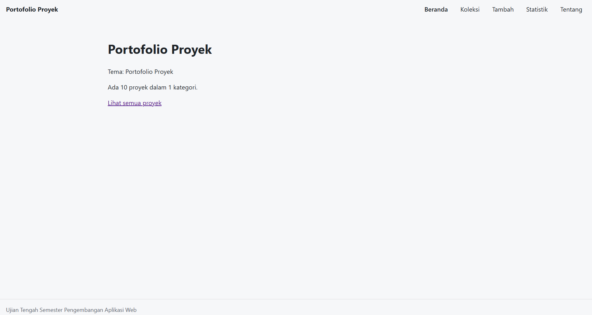
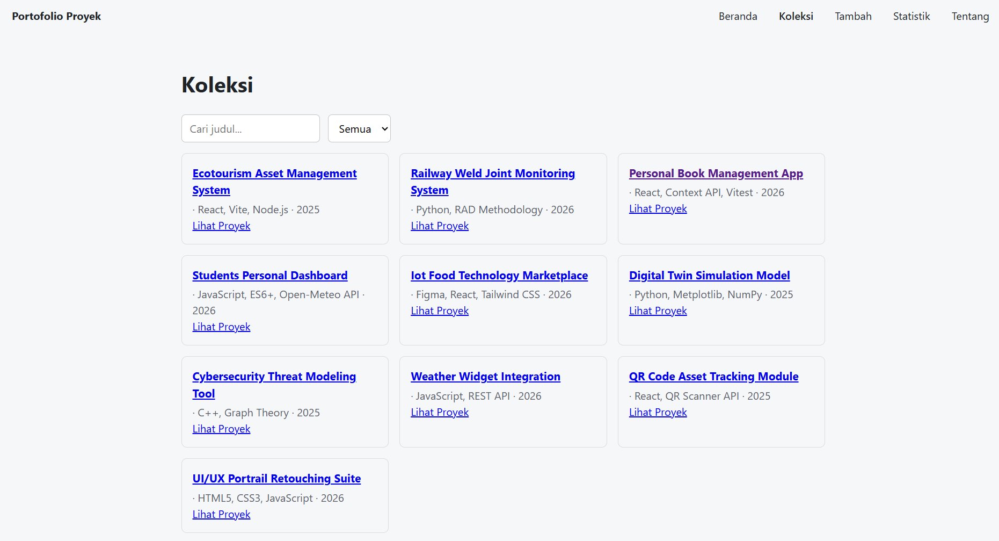
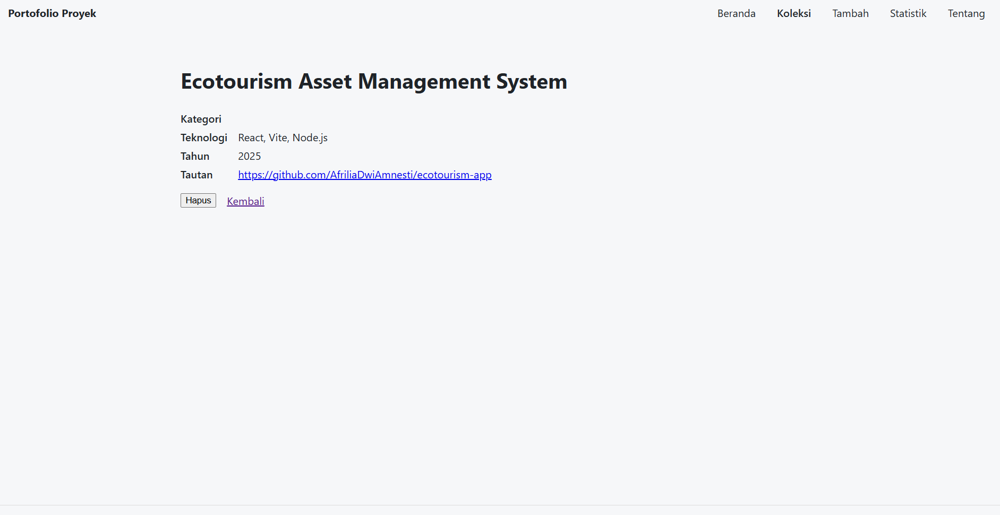
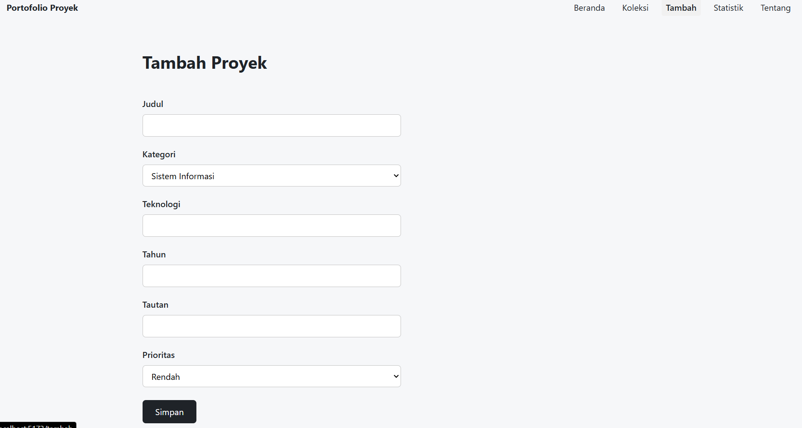
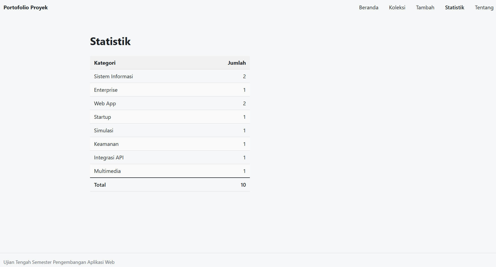
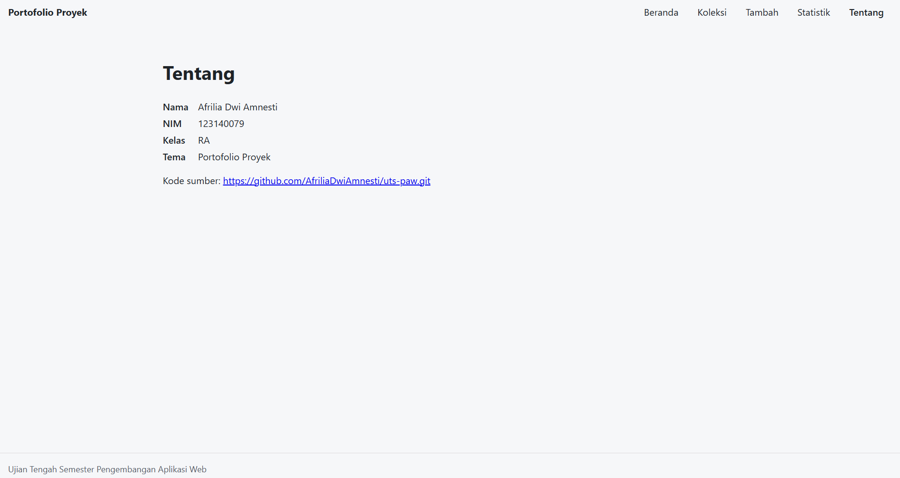

# Portofolio Proyek

Nama: Afrilia Dwi Amnesti
NIM: 123140079
Kelas: RA
Tema: Portofolio Proyek
Deployment: https://afriliadwiamnesti.github.io/uts-paw/

## Fitur

- Beranda: Menampilkan informasi tema, serta ringkasan jumlah total proyek dan kategori.
- Koleksi: Menampilkan seluruh daftar proyek dalam bentuk kartu (card) yang dilengkapi fitur pencarian judul dan filter berdasarkan kategori.
- Detail Item: Menampilkan informasi lengkap suatu proyek (seperti kategori, teknologi, tahun, dan tautan repositori GitHub) beserta tombol untuk menghapus item dan tombol kembali.
- Tambah: Menyediakan formulir untuk menambahkan data proyek baru lengkap dengan pilihan kategori.
- Statistik: Menampilkan tabel jumlah proyek berdasarkan masing-masing kategori beserta total keseluruhan proyek.
- Tentang: Memuat informasi identitas pembuat (Nama: Afrilia Dwi Amnesti, NIM: 123140079, Kelas: RA, Tema: Portofolio Proyek) serta tautan ke repositori kode sumber GitHub.

## Menjalankan secara lokal

cd app
npm install
npm run dev

## Konsep React yang dipakai

- Komponen Fungsional & Props
- State Management & Hooks bawaan (useState, useEffect)
- React Router
- Controlled Components
- Penyimpanan Lokal & Interaksi Daftar
